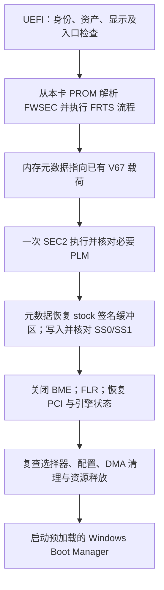

# RTX 4080 SUPER 解锁全过程、补丁逻辑与真实性能报告

记录日期：2026-10-25。时间采用原始记录中的 Australia/Sydney 时区，当日 UTC+11。

后续进展（2026-10-26）：0.2.0 已在本机完成硬盘启动及 **Secure Boot 开启时的 GPU 事务与返回 Windows**，见 [RUN03 实测证据](evidence/secureboot-stage3-0.2.0-run03/README.md) 和 [签名登记说明](SECUREBOOT-SIGNING.zh-CN.md)。该轮没有重新跑性能基准；本文下方的 0.1.2、Secure Boot 关闭条件及原始 FP32/Tensor 数据保持原样。

本报告对应本机 RTX 4080 SUPER 16GB、Windows 11 Pro、Secure Boot 关闭、自定义 UEFI 程序先于 Windows 显卡驱动执行的实验。成功程序版本为 **stage3-0.1.2**，成功实机记录为 **RUN05**。

已取得的证据是：选择器写入及 FLR 前后读回通过、硬件恢复与释放检查通过、用户确认自动进入 Windows，以及同一启动周期内两次原始 GEMM 基准测得 Tensor 吞吐提升。**FP32_STRICT 没有提升，三种尺寸的两次均值均小幅下降。**

本文把“解锁成功”限定在这次启动的控制状态变化和实测 GEMM 加速。没有刷写 VBIOS、替换 Windows NVIDIA 驱动，也没有证明永久生效、全部应用加速、数值正确性或长期稳定性。

## 1. 本机环境

| 项目 | 本次记录 |
|---|---|
| GPU | NVIDIA GeForce RTX 4080 SUPER，AD103，16GB |
| PCI ID / subsystem | `10de:2702` / `19da:4702` |
| PCI 位置 / revision | `0000:01:00.0` / `A1` |
| 芯片寄存器 | `0x193000a1` |
| 显存报告值 | 16376 MiB |
| OS | Windows 11 Pro；基准记录为 `Windows-11-10.0.26200-SP0` |
| NVIDIA 驱动 | `581.57`，前后相同 |
| VBIOS | `95.03.44.00.dd`，前后相同 |
| 功耗限制 | `320.00 W`，前后相同 |
| Python / PyTorch / CUDA | `3.13.12` / `2.12.1+cu130` / `13.0` |
| Compute Capability | `(8, 9)` |
| UEFI 显示 | Intel 核显提供 GOP，NVIDIA 卡没有固件驱动占用 |
| 入口 PCI Command / Attributes 缓存 | `0` / `0` |
| BAR0 | 基址 `0x83000000`，长度 `0x01000000` |
| Secure Boot | 本路线保持关闭 |

原 Python 路径：

```text
F:\Comfy-Desktop\ComfyUI-Installs\default\ComfyUI\.venv\Scripts\python.exe
```

关闭 Secure Boot 用于启动这套自定义 EFI；GPU 内部权限变化仍依赖后续 FWSEC/SEC2 流程。不能把关闭 Secure Boot 本身描述为 GPU 解锁。

## 2. 研究来源与本次新增工作的边界

主要参考为 [TOTORONG/AD103_win_unlocker](https://huggingface.co/TOTORONG/AD103_win_unlocker)，本地源码位于 `research/AD103_win_unlocker`，固定提交：

```text
51df9c17ec89eb8486df52cc9079dde4bd1f9974
```

该参考以普通 RTX 4080 的另一块板卡及 32GB 实验配置为背景。目标身份、BAR、显存布局、启动显示所有权和 PCI 入口状态不能直接套用本机。早期诊断还参考了 [JustAResearcher/gpu-unlock-ada](https://github.com/JustAResearcher/gpu-unlock-ada)，本地路径 `research/gpu-unlock-ada`，固定提交 `4e7fefcc4923f9e083d5324dc75a7d2f906af77f`。

本次按固定哈希原样使用参考项目已有的 `v67-ad102-610.43.03-four-plm.bin`。**没有重新制作该二进制载荷，也不把其漏洞发现、签名攻击研究或底层二进制设计归为本次原创。** 本次新增的是本机 UEFI 适配、ROM/FWSEC/显存布局校验、PCI/DMA 生命周期、严格成功判据、恢复与诊断补丁，以及 Windows 性能验证。

参考项目根 `ASSETS-MANIFEST.json` 与实际入口 `app_io.c` 选择 AD102 资产；旧 `source/unlock/assets.json` 中 GA102 项属于遗留清单。早期笔记中的资产不一致疑问已在后续核对解决，最终包使用固定的一套 AD102 资产。

资产版本字符串 `610.43.03` 是启动前载荷来源版本；Windows 依旧使用 `581.57`。没有安装该版本的 Linux 包或把 Windows 驱动升级到 610。

## 3. 完整开发与实机过程

| 阶段 | 证据文件 | 结果与后续处理 |
|---|---|---|
| 原始基线 | `171931.json`、`172003.json` | 相同脚本连续两次；8192 FP16/BF16 约 108 TFLOPS |
| 原始 ROM 备份 | `rtx4080super_original.rom` | 2048000 字节，保留哈希；离线 FWSEC/FRTS 修改仅作用于内存副本 |
| Stage1 | `CAP0001.JSON` | 获取身份、资源、显示与占用拓扑，确定本机入口条件 |
| Stage2 初版 | `CAP_STAGE2_0001.JSON` | 错误要求 WPR2 高低寄存器都为 0，过早停止；未读取 PROM，恢复检查通过 |
| Stage2 修正版 | `CAP_STAGE2_0002.JSON` | 21 个寄存器及双遍 1 MiB PROM 读取成功，入口配置恢复通过 |
| Stage3 0.1.0 | `REPORT_STAGE3_RUN00.TXT`，内部实际 RUN01 | 核心事务和选择器通过，最后 entry-restore 停止；旧日志未记下具体差异 |
| Stage3 0.1.1 | `REPORT_STAGE3_011.TXT`，内部 RUN03 | 修复 STOP 二次误报、补齐诊断；查明唯一差异是 PCIe Device Status `9→0` |
| Stage3 0.1.2 | `REPORT_STAGE3_012.TXT` / `REPORT.TXT`，内部 RUN05 | 精确处理已确认状态变化，恢复与释放通过，用户确认自动进入 Windows |
| Windows 验证 | `results/20261025-220124-082` | 报告核对成功，原 Python 环境执行两次原始基准，得到下文数据 |

RUN 编号是 U 盘运行记录编号，不是版本号；复制到电脑后的文件名也可能与内部 RUN 编号不同。RUN04 是按键等待超时，`attempted=0 firmware_started=0`，不属于已执行固件的失败实验。

### 3.1 Stage2 的 WPR2 判据修正

初版要求 WPR2 LO/HI 同时为 0，本机实际为 `HI=0`、`LO=0x1ffffe00`。修正版仍严格要求 HI 为 0，并对已观察到的 LO 进行约束。没有把本机观察推导为所有 AD103 的固定默认值。

Stage2 的有效四镜像 ROM 链 `[0,0x9a200)` 共 631296 字节，与备份 ROM 的 `0x9400` 和 `0xe9400` 两个视图逐字节相同。完整 1 MiB 窗口的差异位于有效链之外，没有触及 FWSEC。不能据此确定物理副本身份或声称已经读取全部 VBIOS 存储。

### 3.2 按真实 16GB 输入计算布局

`FB_SIZE_MB=0x3ff8`，可用显存上界为 `0x3ff800000`。按参考算法，VGA 顶部保留区回退为 `0x3ff700000`；MMU 锁高地址上取整后为 `0x3cf800000`，未覆盖显存顶部，因此不作为顶部布局约束。

| 区域 | 本机计算值 |
|---|---|
| non-WPR 起点 | `0x3f4b00000` |
| WPR 起点 | `0x3f4c00000` |
| heap 起点 / 大小 | `0x3f4d00000` / `0x05800000`（88 MiB） |
| GSP 映像起点 | `0x3fa5a0000` |
| boot 起点 | `0x3ff5f7000` |
| FRTS 起点 | `0x3ff600000` |
| WPR 终点 | `0x3ff700000` |

先用真实资产尺寸进行离线布局/边界验证，再由实机日志确认采用相同布局。离线计算成功与固件运行成功是两类独立证据。

## 4. 解锁链路本身的逻辑



### 4.1 FWSEC 与 V67 发布

FWSEC 从已固定哈希的本卡 PROM 视图解析：映像偏移 `0x45b48`，大小 `0x10500`；签名版本选择依据读取的 fuse/version 字段，FRTS 使用本机布局地址。程序核对 FWSEC scratch/WPR2 结果，再继续下一阶段。

`unlock_transaction_signature()` 第一次调用时，经 `gpu_unlock_wpr_meta_pack()` 构造内存元数据，把签名地址/大小指向 V67 载荷。随后运行一次 SEC2 Booter 流程，核对 marker、HALT 和 PLM 读回。

第二次调用把元数据偏移 `72`、`80` 分别改回 `stock_dma` 和 `stock_size`，再执行内存屏障。所谓“恢复 stock 签名”是**本次事务内存元数据中的指针/长度恢复**，不是刷写 ROM、重新签发固件签名或修改 Windows 驱动文件。

本文说明的是源码调用链、元数据操作和实机结果；没有重新反汇编验证 V67 二进制内部每条指令，也没有证明其依赖的签名/验证缺陷的全部底层机理。

### 4.2 PLM 读回：不能把四项都写成成功

| 目标 | BAR0 偏移 | 期望值 | 本机最终值 | 判定 |
|---|---|---|---|---|
| WPR_CFG | `0x1fa7cc` | `0xfffff0ff` | `0xfffff0ff` | 必须匹配，通过 |
| FBPA | `0x9a0148` | `0xffffffff` | `0xffffff0f` | 不匹配，按既有策略列为非必要项 |
| WPR | `0x1fa7c4` | `0xffffffff` | `0xffffffff` | 必须匹配，通过 |
| FEAT | `0x823804` | `0xffffffff` | `0xffffffff` | 必须匹配，通过 |

真实报告是 `required_plm=1 all_plm=0`。FBPA 保持原值时仍测到了本文的 GEMM 加速，但不能推广成 FBPA 对所有应用都无影响。

### 4.3 选择器写入

| 选择器 | BAR0 偏移 | 原值 | 目标及读回值 |
|---|---|---|---|
| SS0 | `0x82381c` | `0x64113035` | `0x88888888` |
| SS1 | `0x823820` | `0x00000002` | `0x00000008` |

参考实现把 SS0 处理为八个 4 位字段，SS1 使用低 4 位，目标每字段为 8。写后以及 FLR 后都必须核对读回，不凭 API 返回成功认定生效。

本次有选择器变化与吞吐提升的同次实验证据，但没有把每个 nibble 映射到完整公开的 NVIDIA 微架构语义，也未在 Windows 驱动接管后直接重新读取这些寄存器。

### 4.4 PCI、DMA、FLR 与 Windows 交接

直接 16 位 PCI Command 写入形成 `0→2→6→2→0`：开 Memory Space、执行阶段开 Bus Master、清理时关 Bus Master、最后恢复入口。Attributes 缓存按实测条件保持 0，不调用 Attributes Enable/Disable 改动上游桥。

DMA 经 `AllocateBuffer` / `Map(BusMasterCommonBuffer)` 分配和映射，要求长度完整、4 KiB 对齐且全部地址低于 4 GiB；映射失败不改用裸物理地址。无法确认引擎静止或释放失败时保留资源并 STOP。

FLR 前关闭 BME；FLR 后恢复必要 PCI 配置并检查 GSP HALT、WPR2 高位、选择器和 DMA 收尾。最后核对上游桥、Intel GOP 与占用释放，再启动预加载的内部 `bootmgfw.efi`。没有修改 BootOrder/BootNext 或断开 Intel 显示驱动。

## 5. 本次新增补丁的具体逻辑

### 5.1 本机入口与 MSVC 适配

以本机 `2702/19da:4702`、AD103、16GB、固定 BAR、CAP 寄存器/PROM 证据替换参考板卡的不同身份、32GB 和显示所有权假设。使用非抢占 BY_DRIVER 占用，不强制 DisconnectController。

程序使用 MSVC C11 编译无 CRT 的 x64 EFI，兼容层包含 MSVC 内存屏障、显式字节指针运算和受边界检查保护的窄化转换。固件资产和源文件哈希固定在清单中。

### 5.2 清理成功不能覆盖解锁失败

参考代码存在选择器不匹配但仍继续恢复并最终返回 0 的路径。本次逻辑为：

```text
selector_result = 写入并核对 SS0、SS1
若为可读的不匹配：仍允许 FLR 清理继续
清理结束后，若 selector_result 非零，或 FLR 前/后选择器不匹配：最终返回失败
若 Unmap/FreeBuffer 等收尾失败：recovered=0，不能返回成功
```

新增 outcome 分开报告 firmware_started、required_plm_verified、all_plm_verified、selectors_before_flr、selectors_after_flr、recovered 和 result。外层应用还再次核对 SS0/SS1、WPR2 与 GSP。

### 5.3 0.1.1：STOP 误报修复与诊断

0.1.0 的 STOP 使用了要求工作态 Command=2 的 `GuClearMaster()`。当最后恢复已经把 Command 置为 0，再调用它会额外产生 EFI_DEVICE_ERROR 和 fault=1，掩盖原始停止原因。

0.1.1 将核心清理和 STOP 隔离区分：

- `GuClearMaster()` 继续要求核心工作态为 Command 2。
- `GuContainMasterForStop()` 在 STOP 中接受已关闭 BME 的 Command 0 或 2；这不会授权 Windows 交接或释放不确定的 DMA。

恢复步骤、API 状态、Command 前后值、Attributes、配置读回和每个不同 dword 都被记录。出错时先隔离 BME，再输出 USB 日志，避免日志 I/O 延迟隔离；STOP cause 保留隔离前的 fault/retained。

### 5.4 0.1.2：精确修正 Device Status 清零误判

RUN03 唯一差异：

```text
entry command restore detail: step=complete api_status=0 ... before=0x2 after=0 attributes=0
entry config delta: offset=0x80 entry=0x92930 final=0x2930 xor=0x90000
```

本卡 PCIe capability 位于 `0x78`，所以 `0x80` 的低 16 位是 Device Control，高 16 位是 `0x82` 的 Device Status：

| 字段 | 地址 | 原值 → 终值 |
|---|---|---|
| Device Control | `0x80` | `0x2930 → 0x2930`，未变化 |
| Device Status | `0x82` | `0x0009 → 0x0000` |

Device Status bit0 是 Correctable Error Detected，bit3 是 Unsupported Request Detected；它们在原始 Stage2 快照中已经置位。本次事务后历史错误记录位清零，不是 Device Control 恢复丢失。日志没有单独定位具体清零操作，因此不把精确清零时刻归因于 FLR。

0.1.2 只在最终 CPU 内存快照比较中接受这一个精确变化。以下为成功构建的实际源码：

```c
static BOOLEAN FinalEntryMatches(const UINT32 final[64],const UINT32 entry[64],
                                BOOLEAN verifiedFlr,UINT16 pcie,BOOLEAN *accepted) {
    UINT32 normalized[64];*accepted=FALSE;
    if(!memcmp(final,entry,sizeof(normalized)))return TRUE;
    if(!verifiedFlr||pcie!=0x78||entry[0x80/4]!=0x00092930||final[0x80/4]!=0x00002930)return FALSE;
    memcpy(normalized,final,sizeof(normalized));normalized[0x80/4]=entry[0x80/4];
    if(memcmp(normalized,entry,sizeof(normalized)))return FALSE;
    *accepted=TRUE;return TRUE;
}
```

verifiedFlr 只在核心事务、outcome、最终选择器/GSP 检查成功后设置，还要求 `Gu.flrs==1 && Gu.started && Gu.quiesced && !Gu.fault`。单独“曾尝试一次 FLR”不够。

normalized 是栈上的配置副本；改回一个 dword 是为了比较其余字节，**没有向显卡写回错误状态位**。新错误位、部分清零、控制位变化、其他偏移变化及启动前出现相同差异，都没有获得放行例外。

因此这个补丁修正的是恢复判据；性能解锁载荷与 PLM/选择器流程没有在 0.1.2 中更换。

## 6. 成功报告与验证命令报错的处理

RUN05 的关键原始日志：

```text
TRANSACTION OUTCOME: result=0 firmware_started=1 required_plm=1 all_plm=0 selectors_before_flr=1 selectors_after_flr=1 recovered=1
final selector/gsp readback: SS0=0x88888888 SS1=0x8 WPR2_HI=0 GSP_CPUCTL=0x10
entry status policy: verified_flr=1 accepted_ced_urd_clear=1 configuration_accepted=1
release={"bridge_status":"0x0000000000000000","owners_status":"0x0000000000000000","display_status":"0x0000000000000000","close_status":"0x0000000000000000","reservation_released":true}
FINAL status=0 phase=transaction attempted=1 firmware_started=1 restored_entry_command=0 performance_validated=0
```

UEFI 中 performance_validated=0 表示它尚未执行 Windows 基准；之后用户确认自动进入 Windows，才采集了两次性能数据。build manifest/validation 的 hardware_tested=false 以及 context 的 performance_verified=false 也反映各自创建时状态。本文使用后续新证据，不回改历史文件制造“构建时已经验证”的记录。

最初 Resolve-Path 报错是因为 `F:\AI\unlock_gpu\REPORT_STAGE3_012.TXT` 尚未复制到位。随后找到 U 盘 `G:\RTX4080S-UNLOCK\RUN05\REPORT.TXT`，复制并完成采集。用户后来提供的 `F:\AI\unlock_gpu\REPORT.TXT` 与这两份报告 SHA256 完全一致。

本次真实路径下的操作命令为：

```powershell
Copy-Item -LiteralPath 'G:\RTX4080S-UNLOCK\RUN05\REPORT.TXT' -Destination 'F:\AI\unlock_gpu\REPORT_STAGE3_012.TXT'
powershell -NoProfile -ExecutionPolicy Bypass -File 'F:\AI\unlock_gpu\windows_unlock_4080super\Collect-AfterBoot.ps1' -Report 'F:\AI\unlock_gpu\REPORT_STAGE3_012.TXT'
```

G: 和 RUN05 是本次实际位置。未来应选择对应新启动的最新报告，不能用旧成功报告证明新启动状态。采集必须在该次自动交接到 Windows 的启动周期内完成；本次已完成，无需为阅读本文再次运行。

## 7. 测试方法、统计口径与全部真实数据

脚本 `rtx4080s_tensor_baseline.py` 和原 ComfyUI Python 环境前后相同。

- 方阵 n=2048/4096/8192，每种 dtype 分别比较。
- 每项 warmup 8 次，5 个 trial，每 trial 执行 15 次，CUDA Event 计时。
- 每 trial 平均每次 GEMM 耗时，再取 5 个 trial 中位数。
- `TFLOPS = 2 × n³ / (median_ms × 10⁻³) / 10¹²`，是按 GEMM 运算量计算的有效吞吐。
- FP32/FP16/BF16 使用 torch.mm；FP8 E4M3 使用 torch._scaled_mm、BF16 输出、use_fast_accum=False；该 FP8 路径包含缓存分配器下的输出分配。
- FP32 使用 highest、allow_tf32=False；没有把 TF32 算作严格 FP32。
- FP16/BF16 reduced-precision-reduction 前后均为 True；torch.manual_seed(4080)，输入生成与调用逻辑一致。

“均值”是两份运行 JSON 报告的 TFLOPS 的算术平均，不是合并全部 trial 的中位数，也不是平均耗时再取倒数：

```text
原始均值 = (S1 TFLOPS + S2 TFLOPS) / 2
后测均值 = (U1 TFLOPS + U2 TFLOPS) / 2
变化 = (后测均值 / 原始均值 - 1) × 100%
```

JSON 耗时已舍入到 5 位小数，TFLOPS 到 3 位小数；两者来自舍入前测量，所以拿显示耗时重新计算可能有末位差异。本文直接使用 JSON 数值，保留两次运行，不挑最快值；两次 TFLOPS 的均值显示 4 位小数。

### 7.1 运行身份

| 代号 | 状态 | JSON 内时间 | 文件 |
|---|---|---|---|
| S1 | 原始 | 2026-10-25T17:19:26+11:00 | [rtx4080s_tensor_stock_20261025_171931.json](<rtx4080s_tensor_stock_20261025_171931.json>) |
| S2 | 原始 | 2026-10-25T17:19:58+11:00 | [rtx4080s_tensor_stock_20261025_172003.json](<rtx4080s_tensor_stock_20261025_172003.json>) |
| U1 | 解锁后 | 2026-10-25T22:01:34+11:00 | [benchmark-1.json](<results/20261025-220124-082/benchmark-1.json>) |
| U2 | 解锁后 | 2026-10-25T22:01:42+11:00 | [benchmark-2.json](<results/20261025-220124-082/benchmark-2.json>) |

后测原脚本仍显示 STOCK 标题和 stock 文件名，这是脚本固定命名，不代表后测处于未解锁状态。U1/U2 分别对应根目录的 `rtx4080s_tensor_stock_20261025_220139.json`、`rtx4080s_tensor_stock_20261025_220147.json`。状态由 context、成功 REPORT 与实际执行顺序判定。

### 7.2 全部吞吐（TFLOPS）

| n | 类型 | S1 | S2 | U1 | U2 | 原始均值 | 后测均值 | 变化 |
|---:|---|---:|---:|---:|---:|---:|---:|---:|
| 2048 | FP32_STRICT | 34.929 | 34.953 | 34.769 | 34.935 | 34.9410 | 34.8520 | -0.25% |
| 2048 | FP16 | 79.287 | 79.045 | 148.121 | 148.734 | 79.1660 | 148.4275 | +87.49% |
| 2048 | BF16 | 79.173 | 78.865 | 146.228 | 149.352 | 79.0190 | 147.7900 | +87.03% |
| 2048 | FP8_E4M3 | 146.337 | 145.383 | 249.909 | 251.156 | 145.8600 | 250.5325 | +71.76% |
| 4096 | FP32_STRICT | 35.176 | 35.103 | 33.454 | 35.080 | 35.1395 | 34.2670 | -2.48% |
| 4096 | FP16 | 96.463 | 95.218 | 162.504 | 174.854 | 95.8405 | 168.6790 | +76.00% |
| 4096 | BF16 | 100.635 | 101.084 | 162.676 | 174.263 | 100.8595 | 168.4695 | +67.03% |
| 4096 | FP8_E4M3 | 207.425 | 208.090 | 350.701 | 351.601 | 207.7575 | 351.1510 | +69.02% |
| 8192 | FP32_STRICT | 35.902 | 35.597 | 33.933 | 35.271 | 35.7495 | 34.6020 | -3.21% |
| 8192 | FP16 | 108.229 | 108.196 | 173.496 | 174.490 | 108.2125 | 173.9930 | +60.79% |
| 8192 | BF16 | 108.276 | 108.207 | 182.126 | 180.823 | 108.2415 | 181.4745 | +67.66% |
| 8192 | FP8_E4M3 | 209.721 | 189.112 | 299.494 | 297.909 | 199.4165 | 298.7015 | +49.79% |

### 7.3 FP32 单独对比：没有提升

| n | 原始均值 TFLOPS | 后测均值 TFLOPS | 变化 |
|---:|---:|---:|---:|
| 2048 | 34.9410 | 34.8520 | **-0.25%** |
| 4096 | 35.1395 | 34.2670 | **-2.48%** |
| 8192 | 35.7495 | 34.6020 | **-3.21%** |

本次 FP32 三种尺寸均小幅下降，不能删去负数或写成“所有精度提升”。两次运行不足以判断下降是否由补丁造成：温度、频率、后台 GPU 活动未严格控制，没有交替 A/B 冷启动实验或置信区间。

原始 8192 FP8 两次分别为 209.721、189.112 TFLOPS，本身已有明显波动。+49.79% 是规定均值口径下的本次结果，不保证未来每次运行都达到相同比例。

### 7.4 全部耗时与吞吐原始汇总

每个单元格为 `median_ms / TFLOPS`。

| n | 类型 | S1：ms / TFLOPS | S2：ms / TFLOPS | U1：ms / TFLOPS | U2：ms / TFLOPS |
|---:|---|---:|---:|---:|---:|
| 2048 | FP32_STRICT | 0.49186 / 34.929 | 0.49152 / 34.953 | 0.49412 / 34.769 | 0.49177 / 34.935 |
| 2048 | FP16 | 0.21668 / 79.287 | 0.21734 / 79.045 | 0.11599 / 148.121 | 0.11551 / 148.734 |
| 2048 | BF16 | 0.21699 / 79.173 | 0.21784 / 78.865 | 0.11749 / 146.228 | 0.11503 / 149.352 |
| 2048 | FP8_E4M3 | 0.11740 / 146.337 | 0.11817 / 145.383 | 0.06874 / 249.909 | 0.06840 / 251.156 |
| 4096 | FP32_STRICT | 3.90721 / 35.176 | 3.91529 / 35.103 | 4.10836 / 33.454 | 3.91782 / 35.080 |
| 4096 | FP16 | 1.42478 / 96.463 | 1.44342 / 95.218 | 0.84576 / 162.504 | 0.78602 / 174.854 |
| 4096 | BF16 | 1.36572 / 100.635 | 1.35965 / 101.084 | 0.84486 / 162.676 | 0.78868 / 174.263 |
| 4096 | FP8_E4M3 | 0.66260 / 207.425 | 0.66048 / 208.090 | 0.39190 / 350.701 | 0.39089 / 351.601 |
| 8192 | FP32_STRICT | 30.62530 / 35.902 | 30.88758 / 35.597 | 32.40277 / 33.933 | 31.17281 / 35.271 |
| 8192 | FP16 | 10.15910 / 108.229 | 10.16224 / 108.196 | 6.33738 / 173.496 | 6.30129 / 174.490 |
| 8192 | BF16 | 10.15474 / 108.276 | 10.16122 / 108.207 | 6.03709 / 182.126 | 6.08058 / 180.823 |
| 8192 | FP8_E4M3 | 5.24274 / 209.721 | 5.81407 / 189.112 | 3.67123 / 299.494 | 3.69077 / 297.909 |

每份 JSON 还保留 5 个 trial_ms、重复次数、kernel 标签和环境，可用于进一步分析。

## 8. 已验证范围与未验证事项

| 项目 | 当前结论 |
|---|---|
| 必要 PLM、SS0/SS1 写后与 FLR 后读回 | RUN05 已记录通过 |
| Command、Attributes、最终配置与释放 | RUN05 已记录通过 |
| 自动进入 Windows | 用户确认，随后原驱动下 CUDA 基准运行成功 |
| 本次启动 GEMM 吞吐 | 两次后测完成；Tensor 类型提高、FP32 无提升 |
| 调用与环境可比性 | dtype/API/kernel 标签及环境相同；未用 profiler 确认库底层派发完全相同的机器码 kernel |
| 数值正确性 | 仅测吞吐，未独立对照高精度参考结果核验误差 |
| ComfyUI 出图速度与质量 | 尚未测量，不能直接套用 GEMM 百分比 |
| 温度、功耗曲线、长期稳定性 | 未完成系统测试 |
| 跨重启或断电保留 | 未验证，不应假定永久生效 |
| 其他显卡或其他 4080 SUPER 板卡 | 未验证，当前入口与精确例外为本机特定条件 |

采集前 nvidia-smi 观察到约 20–23% GPU 利用率和约 232 MiB 显存占用，未找到额外 Python/ComfyUI 进程；这不能证明没有后台 GPU 活动。前后基线相隔数小时，频率、温度和后台状态未锁定。本报告是实际观察记录，不将其包装成严格受控实验或理论峰值。

用户实际执行了 UEFI 启动；助手在 Windows 中读取与复制报告、运行基准，没有通过工具代用户重启、刷写 VBIOS 或改动驱动。

## 9. 构建、测试与复现

成功程序使用 MSVC 2022、C11、/W3 /WX 构建无 CRT 的 AMD64 EFI，校验重定位和无导入等产物条件。

```powershell
Set-Location 'F:\AI\unlock_gpu\windows_unlock_4080super'
.\Build.ps1
```

构建只生成和校验文件，不执行 EFI 或自动重启；固定资产与编译器须已准备。本版主机测试结果：

- Port：PASS: 14369 port assertions; direct command, DMA retention, FLR restore, STOP at command zero; host mocks only.
- App：app: 6910 assertions, 42 application integration scenarios passed; non-app layers mocked, no hardware execution
- Admission：admission: 2141 assertions, 27 topology/ownership/failure scenarios passed
- Core：43 个事务场景。

App 覆盖 RUN03 精确变化放行、新增错误位拒绝、控制位变化拒绝、启动前状态变化拒绝、缺少已验证 FLR 时拒绝；比较函数还检查允许快照基础上每一位额外翻转均被拒绝。这些是模拟测试，实机证据来自 RUN05 与 Windows 数据。

本机复现：Secure Boot 关闭、Intel GOP 拓扑保持一致；将成功包的 EFI 和 RTX4080S-UNLOCK 两个目录放到 FAT32 U 盘根目录；完整关机，从一次性启动菜单启动 U 盘，READY 后按 U；成功自动进入 Windows。STOP 或挂起时按程序提示物理关机，不从失败状态热重启继续实验。

参考[操作说明](README.md)与[启动包组装说明](README.md)。本机固定地址和入口条件不是其他板卡可直接照搬的通用方案。

## 10. 哈希、资产和源码证据索引

相对路径以本文所在目录 `F:\AI\unlock_gpu` 为基准。

构建 ID：`7273579f318e02b02d635f40d5dfe7f2785470fa491d292f555960f6703d19f2`

EFI SHA256：`252db18d5b170cb338ac5cb8944d9c77a93106f2ecd30ffad32d1354d658c7c2`

USB ZIP SHA256：`b7a3dbed2aaf50ff71b56e0efe0fd50d124a8ed888e2f5c50c52f80bdc43b5bf`

| 文件 | SHA256 |
|---|---|
| `rtx4080super_original.rom`（仅记录哈希；未分发） | `6e298acaa695055754f9751ef3536eeb3fc20d3590dfe1131b83170051eb20c7` |
| `CAP0001.JSON`（仅记录哈希；未分发） | `c1f51fbfa937e86898638906ccc36c0f9a9f8d58025bb240b4c8475693ec1704` |
| `CAP_STAGE2_0001.JSON`（仅记录哈希；未分发） | `1c15c9fd34d9af3f670a4551d1d5704a9728db0134242287fb361dba7c70c74a` |
| `CAP_STAGE2_0002.JSON`（仅记录哈希；未分发） | `4c65ad8928ef717eccd4cc59b32b4e0a6a69a85bb143a55055cb2818b59f67ea` |
| [REPORT_STAGE3_RUN00.TXT](<REPORT_STAGE3_RUN00.TXT>) | `a676c94981888577db4eabae06c198e1a1c090813b17f4e5cf2ab4ab2464d8a1` |
| [REPORT_STAGE3_011.TXT](<REPORT_STAGE3_011.TXT>) | `840c8b6a61395014a3696cb6960e5bd19ff90b3d6e3edfb61a316f314257b50e` |
| [REPORT.TXT](<REPORT.TXT>) | `30c5c70918984f4e93104eddf47d7585c28eecb4db8bc784b308f5667646afd2` |
| [rtx4080s_tensor_baseline.py](<rtx4080s_tensor_baseline.py>) | `9f96279a43f8d5a72e60a9deaf2327e2701c6a2b9e5f882930dff5f30ef5d9b2` |
| [rtx4080s_tensor_stock_20261025_171931.json](<rtx4080s_tensor_stock_20261025_171931.json>) | `2296c2c01683a72ae93e7ba7e7365c372bfa3b66894543068d82423ee536f0b1` |
| [rtx4080s_tensor_stock_20261025_172003.json](<rtx4080s_tensor_stock_20261025_172003.json>) | `c30248c14a8e569085f65a749d7b73fbc8fc4d6dfec8ac60052008b115abf376` |
| [benchmark-1.json](<results/20261025-220124-082/benchmark-1.json>) | `7aaf3314f0535bca3207f3ad1d6a4953fdc63843f3662b5d3bda1de3fea0bfe6` |
| [benchmark-2.json](<results/20261025-220124-082/benchmark-2.json>) | `f2488c87f15706a80d987ff73c7be2a128e2966114be93181f9601419f47abf8` |

### 10.1 固定资产

| 文件 | 字节数 | SHA256 |
|---|---:|---|
| `booter_load_ad102.bin` | 57672 | `6ee05b20e1dc244c08c052f36ef28469b8d09f4955d1fe33e48a179e11a7fd49` |
| `gsp_boot_ad102.bin` | 36864 | `45d6335a8185d6ff13e8d1484cea73f68d3d13aa1c19dc080ed1c3482dd5bac0` |
| `gsp_boot_desc_ad102.bin` | 84 | `83f8f3f1f5f9496e0ea8fc7103c2beb64d0b6de2f5ffe725f13514de5a95fa42` |
| `gsp_ga10x.bin` | 84277400 | `572373620a37418f24dc16b5031c39338778c3257e48e8408de9a57291b24f3a` |
| `v67-ad102-610.43.03-four-plm.bin` | 64000 | `44c36b2d6b3424e53e18f3e55db85c833655de071ce66ce42749588a4a7dc8cb` |

源 URL、档案哈希、提取尺寸见 [assets-layout.json](evidence/assets-layout.json)。Booter/GSP boot 来自固定 NVIDIA 源档案，GSP 来自固定 CachyOS nvidia-utils 包；已有 V67 four-plm 载荷原样保留。

### 10.2 补丁位置

| 源码 | 主要逻辑 |
|---|---|
| [app.c](src/app.c) | 入口、Windows 预加载、成功判据、FinalEntryMatches、STOP 与交接 |
| [port.c](src/port.c) | PCI Command、DMA、FLR 恢复、工作态/STOP 隔离和延迟诊断 |
| [admission.c](src/admission.c) | Intel GOP、桥、所有权与非抢占占用/释放 |
| [unlock_610.c](src/vendor/unlock_610.c) | FWSEC/SEC2、V67/stock 元数据、PLM、选择器、outcome |
| [vbios_610.c](src/vendor/vbios_610.c) | ROM/FWSEC 解析和边界检查 |
| [layout_610.c](src/vendor/layout_610.c) | 真实显存与资产尺寸布局 |
| [app_io.c](src/app_io.c) | 资产哈希与 U 盘日志 |
| [app_tests.c](tests/app_tests.c) | 应用流程和比较函数回归测试 |
| [comparison.json](results/20261025-220124-082/comparison.json) | 四次吞吐、均值、变化及局限 |

早期证据见 [0.1.0 RUN01](evidence/stage3-0.1.0-run01/FINDINGS.txt) 和 [0.1.1 RUN03](evidence/stage3-0.1.1-run03/FINDINGS.txt)。其中“Windows 尚未验证”等文字表示记录当时的状态，最新结论以 RUN05 和本次测量为准。

### 10.3 外部字段定义与本地研究

- [Microsoft：PCI_EXPRESS_DEVICE_STATUS_REGISTER](https://learn.microsoft.com/en-us/windows-hardware/drivers/ddi/miniport/ns-miniport-_pci_express_device_status_register)：Device Status 位定义。
- [Linux v6.17 pci_regs.h](https://github.com/torvalds/linux/blob/v6.17/include/uapi/linux/pci_regs.h)：DEVCTL/DEVSTA 偏移及 CED/URD 常量。
- [NVIDIA 580.95.05 kernel_gsp_tu102.c](https://github.com/NVIDIA/open-gpu-kernel-modules/blob/580.95.05/src/nvidia/src/kernel/gpu/gsp/arch/turing/kernel_gsp_tu102.c)：早期 WPR2 判据核对来源，不据此推断所有 AD103 的 LO 默认值。
- 研究源码以第 2 节的本地固定提交为准；在线仓库后续变化不改变本文构建身份。

本文最初在本机由脚本从保留证据生成；发布时保留测量数值并调整链接。原 ROM、含 PROM 的 CAP 与固件二进制不随仓库分发。公开数据复核命令为 python tools/verify_results.py，不运行 GPU。
